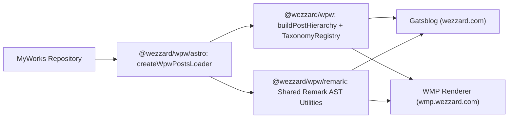

# `@wezzard/wpw`

`@wezzard/wpw` provides the shared content domain model, Remark AST utilities, and Astro 5 Content Layer loaders for WeZZard Personal Works (`MyWorks`).

## Responsibilities

- The core module (`@wezzard/wpw`) parses `MyWorks` relative paths, computes both the 2019 unmasked permalink hash (`hash2019`) and the 2022 16-bit masked identifier (`hashWpw`), clusters canonical and localized posts under `PostMasterRecord` entities, validates kebab-case taxonomy collisions, computes tag occurrence counts, and extracts plain-text MDAST excerpts.
- The Astro integration module (`@wezzard/wpw/astro`) wraps Astro 5's built-in `glob()` Content Layer loader (`createWpwPostsLoader` and `createWpwPagesLoader`) and exports the shared `wpwCommonSchema` Zod definition while preserving native `.md` and `.mdx` compilation.
- The Remark module (`@wezzard/wpw/remark`) provides `createRemarkResolveImages`, `remarkNumberedHeadings`, and `remarkLinksToFootnotes` so target-specific HTML generation remains cleanly isolated inside each renderer's Rehype pipeline.
- The original Gatsby v4 source plugin implementation is preserved under `legacy/`.

## Commands

- Run `npm run build` to compile TypeScript sources from `src/` into `dist/`.
- Run `npm test` to compile and execute the unit test suite via Node.js's built-in test runner.
- Run `npm run typecheck` to verify strict TypeScript types without emitting build artifacts.

## License

- This package is licensed under `0BSD`.
